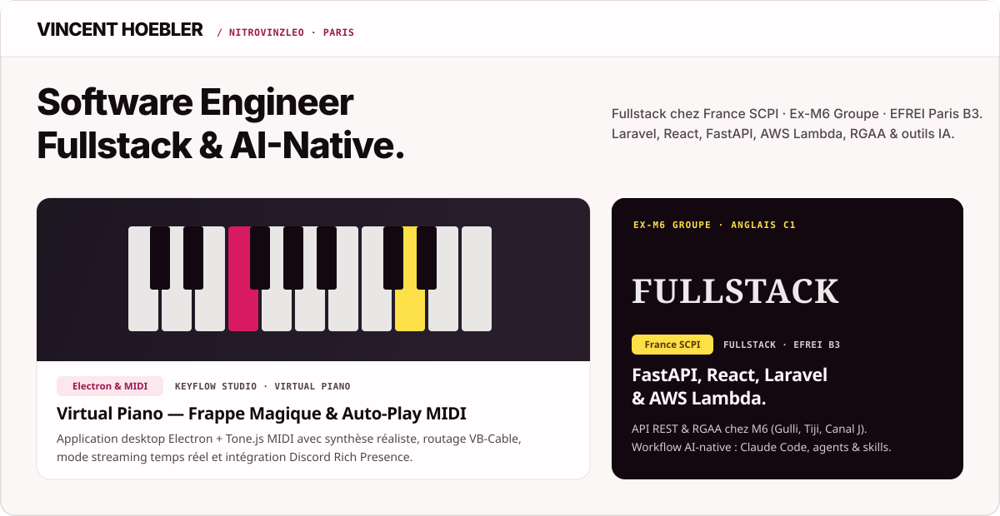

  

 

### À propos

Étudiant en 3e année de **Bachelor Ingénierie et Numérique** à l'**EFREI Paris** (mobilité internationale à Toronto — Anglais **C1**) et **développeur Fullstack en alternance chez France SCPI**.

Après deux expériences chez **M6 Groupe** (API REST FastAPI, fonctions AWS Lambda, mise aux normes accessibilité RGAA), je développe au quotidien avec des workflows **AI-native** (*Claude Code*, agents, skills et règles de sécurité).

---

### Expériences professionnelles

- **Développeur Fullstack (Alternance) — France SCPI** *(En cours)*
  Développement web fullstack (**Laravel / Blade / PHP / JavaScript**), conception d'interfaces et évolution de la plateforme produit.
- **Stage Développeur Backend — M6 Groupe** *(2026)*
  Développement d'API REST en **Python (FastAPI)**, création de fonctions **AWS Lambda** (Python / JavaScript) pour la gestion des avatars de l'application **Gulli**, intégration Front/Back et services **AWS Cloud** (Lambda, DynamoDB).
- **Stage Accessibilité Web — M6 Groupe** *(2025 — 2 mois)*
  Mise en conformité **RGAA** des sites du groupe M6 (notamment **gulli.fr**) et rédaction des guidelines d'accessibilité pour les plateformes jeunesse (**tiji.fr**, **canalj.fr**).

---

### Sélection de projets

| No. | Projet | Stack | Description |
| :--- | :--- | :--- | :--- |
| `01` | **Virtual Piano — KeyFlow Studio** | `Electron` `JS` `MIDI` | Piano virtuel temps réel avec Frappe Magique, Auto-Play `@tonejs/midi`, micro virtuel VB-Cable et Discord RPC. |
| `02` | [**PowderHelpMe**](https://github.com/Nitrovinzleo/PowderHelpMe) | `Electron` `Node.js` `Chart.js` | Application desktop temps réel de suivi de statistiques League of Legends via l'API Riot Games. |
| `03` | [**Forum-UX (Studio Edition)**](https://github.com/Nitrovinzleo/Forum-UX) | `HTML` `CSS` `JS` | Plateforme éditoriale conçue selon les normes WCAG AAA & RGAA 4.1.2. |
| `04` | [**DocTranslate**](https://github.com/Nitrovinzleo/DocTranslate) | `TypeScript` | Pipeline de traduction documentaire typé de bout en bout. |
| `05` | [**Système de Tournois ELO**](https://github.com/Nitrovinzleo/Systeme-de-Tournois-avec-ELO) | `Python` `Streamlit` | Gestionnaire d'arbres de tournois avec calcul dynamique du classement ELO. |

---

### Stack & Compétences IA

- **Web & Back-end** — React.js, Laravel, PHP, Python (FastAPI), JavaScript, TypeScript, HTML/CSS, API REST
- **Cloud & Data** — AWS Cloud (Lambda, DynamoDB), MySQL, Git, GitHub, Figma, Jira, Confluence
- **AI-Native Engineering** — Claude Code, mise en place d'agents & skills, Security Guidelines, Gemini / OpenAI, AntiGravity
- **Architecture & Qualité** — SOLID, Refactoring, Agile / Scrum, RGAA 4.1.2, WCAG AAA

---

### Contact

- **Email :** [vhoebler@gmail.com](mailto:vhoebler@gmail.com)
- **LinkedIn :** Vincent HOEBLER

---

### Activité

  <picture>
    <source media="(prefers-color-scheme: dark)" srcset="https://raw.githubusercontent.com/Nitrovinzleo/Nitrovinzleo/output/github-contribution-grid-snake-dark.svg" />
    <source media="(prefers-color-scheme: light)" srcset="https://raw.githubusercontent.com/Nitrovinzleo/Nitrovinzleo/output/github-contribution-grid-snake.svg" />
    
  </picture>

