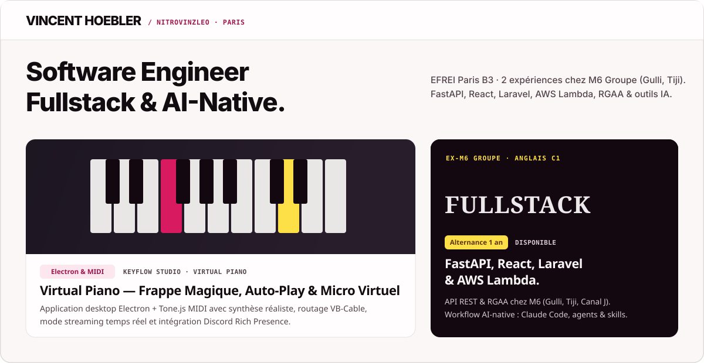

  

 

### Sélection de projets

| :--- | :--- | :--- | :--- |
| `01` | [**FL Studio Live Collaboration**](https://github.com/Nitrovinzleo/-FL-Studio--Plugin-2-collaboration-live-) | `C++` | Plugin temps réel permettant à deux musiciens de composer ensemble en direct. |
| `02` | [**Forum-UX (Studio Edition)**](https://github.com/Nitrovinzleo/Forum-UX) | `HTML` `CSS` `JS` | Plateforme éditoriale conçue selon les normes WCAG AAA & RGAA 4.1.2. |
| `03` | [**DocTranslate**](https://github.com/Nitrovinzleo/DocTranslate) | `TypeScript` | Pipeline de traduction documentaire typé de bout en bout. |
| `04` | [**Système de Tournois ELO**](https://github.com/Nitrovinzleo/Systeme-de-Tournois-avec-ELO) | `Python` `Streamlit` | Gestionnaire d'arbres de tournois avec calcul dynamique du classement ELO. |
| `05` | [**Achievements Playground**](https://github.com/Nitrovinzleo/achievements-playground) | `PowerShell` `Bash` | Boîte à outils multiplateforme pour automatiser les APIs GitHub REST & GraphQL. |

 

### Stack & Disciplines

- **UI / UX & Accessibilité** — Design éditorial, HTML sémantique, CSS moderne, RGAA 4.1.2, WCAG AAA
- **Développement Applicatif** — TypeScript, JavaScript, React, Python, Java, PHP
- **Systèmes & Automatisation** — C++, PowerShell, Bash, Git, Docker, GitHub Actions

 

### Activité

  <picture>
    <source media="(prefers-color-scheme: dark)" srcset="https://raw.githubusercontent.com/Nitrovinzleo/Nitrovinzleo/output/github-contribution-grid-snake-dark.svg" />
    <source media="(prefers-color-scheme: light)" srcset="https://raw.githubusercontent.com/Nitrovinzleo/Nitrovinzleo/output/github-contribution-grid-snake.svg" />
    
  </picture>

