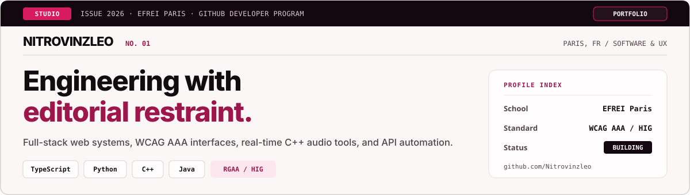

  <picture>
    <source media="(prefers-color-scheme: dark)" srcset="./assets/studio-hero-dark.svg" />
    <source media="(prefers-color-scheme: light)" srcset="./assets/studio-hero-light.svg" />
    
  </picture>

 

### Selected Works

| No. | Project | Stack | Notes |
| :--- | :--- | :--- | :--- |
| `01` | [**FL Studio Live Collaboration**](https://github.com/Nitrovinzleo/-FL-Studio--Plugin-2-collaboration-live-) | `C++` | Real-time plugin architecture for collaborative music production. |
| `02` | [**Forum-UX (Studio Edition)**](https://github.com/Nitrovinzleo/Forum-UX) | `HTML` `CSS` `JS` | Editorial web platform engineered to WCAG AAA & RGAA 4.1.2 standards. |
| `03` | [**DocTranslate**](https://github.com/Nitrovinzleo/DocTranslate) | `TypeScript` | Structured document translation pipeline with strict typing. |
| `04` | [**ELO Tournament System**](https://github.com/Nitrovinzleo/Systeme-de-Tournois-avec-ELO) | `Python` `Streamlit` | Competitive bracket manager with live ELO rating computation. |
| `05` | [**Achievements Playground**](https://github.com/Nitrovinzleo/achievements-playground) | `PowerShell` `Bash` | Cross-platform toolkit automating GitHub REST & GraphQL APIs. |

 

### Discipline & Stack

- **Interfaces & UX** — Semantic HTML, editorial CSS architecture, WCAG AAA contrast, Apple HIG restraint
- **Application Code** — TypeScript, JavaScript, React, Python, Java
- **Systems & Tooling** — C++, PowerShell, Bash, Git, Docker, GitHub Actions

 

### Activity

  <picture>
    <source media="(prefers-color-scheme: dark)" srcset="https://raw.githubusercontent.com/Nitrovinzleo/Nitrovinzleo/output/github-contribution-grid-snake-dark.svg" />
    <source media="(prefers-color-scheme: light)" srcset="https://raw.githubusercontent.com/Nitrovinzleo/Nitrovinzleo/output/github-contribution-grid-snake.svg" />
    
  </picture>

