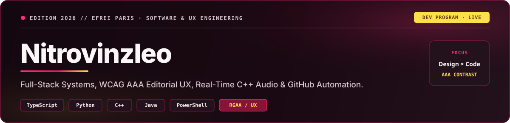

  

  
  
  

---

### Focus

Engineering student at **EFREI Paris** focused on practical software systems: real-time C++ audio plugins, TypeScript/React web interfaces, Python data tooling, and GitHub API automation.

---

### Selected Projects

| Project | Stack | Summary |
| :--- | :--- | :--- |
| [**FL Studio Live Collaboration Plugin**](https://github.com/Nitrovinzleo/-FL-Studio--Plugin-2-collaboration-live-) | `C++` | Real-time plugin architecture enabling two musicians to compose collaboratively inside FL Studio. |
| [**DocTranslate**](https://github.com/Nitrovinzleo/DocTranslate) | `TypeScript` | Automated document translation workflow built with strict typing. |
| [**ELO Tournament System**](https://github.com/Nitrovinzleo/Systeme-de-Tournois-avec-ELO) | `Python` `Streamlit` | Web application managing competitive brackets and dynamic ELO ratings. |
| [**Achievements Playground**](https://github.com/Nitrovinzleo/achievements-playground) | `PowerShell` `Bash` | Cross-platform toolkit and guide automating GitHub REST and GraphQL workflows. |

---

### Core Stack

  

---

### Activity & Telemetry

  
  

  <picture>
    <source media="(prefers-color-scheme: dark)" srcset="https://raw.githubusercontent.com/Nitrovinzleo/Nitrovinzleo/output/github-contribution-grid-snake-dark.svg" />
    <source media="(prefers-color-scheme: light)" srcset="https://raw.githubusercontent.com/Nitrovinzleo/Nitrovinzleo/output/github-contribution-grid-snake.svg" />
    
  </picture>

